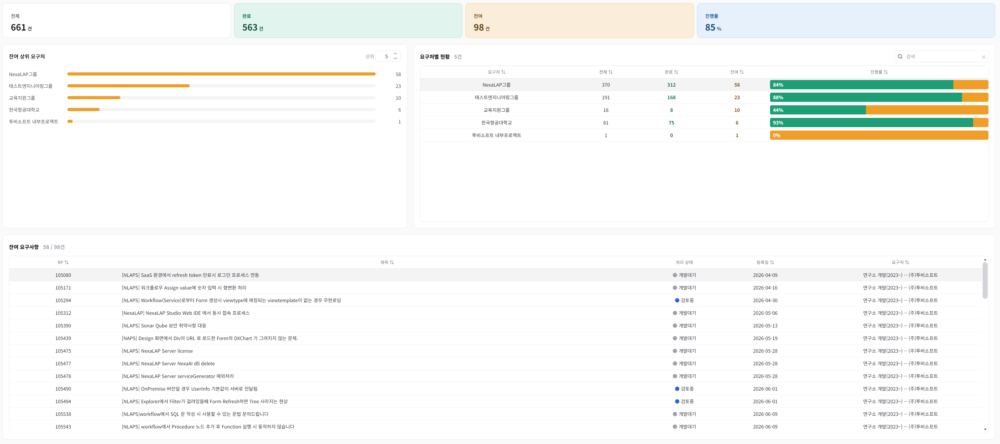

  <a href="../index.md" style="text-decoration:none; font-weight:bold; text-decoration:underline;">Home</a>
  ›
  <strong>ViewSets</strong>
  ›
  DashboardDetail_H

## 📦 Tops_Board_Asset Manual

### 🔺DashboardDetail_H
 > 요약 카드·차트·목록·상세 목록으로 구성된 대시보드 ViewSet

 

#### 1. 기능 정의
상단에 요약 카드, 가운데에 차트와 메인 Grid를 나란히, 하단에 상세 Grid를 배치한 대시보드 화면 구성입니다.

 

#### 2. 구성
<table>
  <thead>
    <tr>
      <th style="text-align:center; min-width:100px;">ID</th>
      <th style="text-align:center; min-width:80px;">종류</th>
      <th style="text-align:center; min-width:120px;">ViewTemplate</th>
      <th style="text-align:center; min-width:200px;">설명</th>
    </tr>
  </thead>
  <tbody>
    <tr>
      <td>Summary</td>
      <td><code>View</code></td>
      <td>SummaryCardView</td>
      <td>상단 요약 카드 영역</td>
    </tr>
    <tr>
      <td>Chart</td>
      <td><code>View</code></td>
      <td>RankBarChart</td>
      <td>왼쪽 순위 차트 영역 (너비 40%)</td>
    </tr>
    <tr>
      <td>Main</td>
      <td><code>View</code></td>
      <td>(Grid)</td>
      <td>오른쪽 메인 목록 영역</td>
    </tr>
    <tr>
      <td>Detail</td>
      <td><code>View</code></td>
      <td>(Grid)</td>
      <td>하단 상세 목록 영역</td>
    </tr>
  </tbody>
</table>

 

#### 3. 참고
- 메인 목록에서 행을 선택하면 상세 목록을 다시 조회하거나 MasterRowFilter로 필터링하는 형태로 주로 사용한다.
