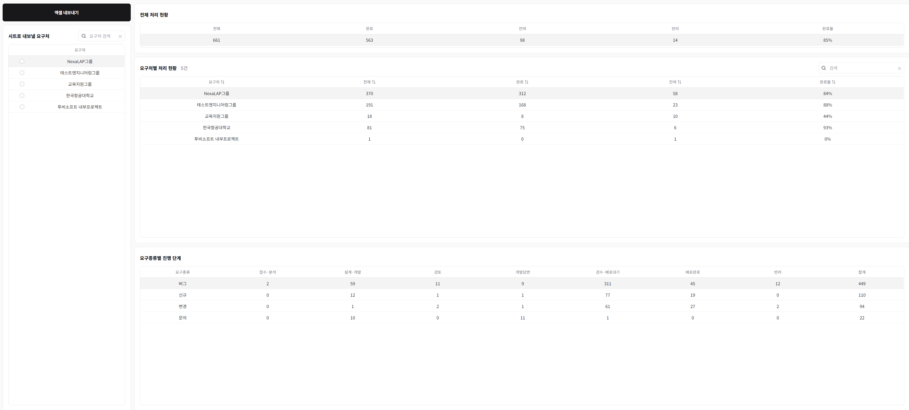

  <a href="../index.md" style="text-decoration:none; font-weight:bold; text-decoration:underline;">Home</a>
  ›
  <strong>ViewSets</strong>
  ›
  ExportReport_H

## 📦 Tops_Board_Asset Manual

### 🔺ExportReport_H
 > 내보내기 버튼·옵션 목록·미리보기 Grid로 구성된 리포트 ViewSet

 

#### 1. 기능 정의
왼쪽에 내보내기 버튼과 옵션(시트 선택) 목록, 오른쪽에 내보낼 표 3개를 위에서 아래로 배치한 리포트 화면 구성입니다.

 

#### 2. 구성
<table>
  <thead>
    <tr>
      <th style="text-align:center; min-width:100px;">ID</th>
      <th style="text-align:center; min-width:80px;">종류</th>
      <th style="text-align:center; min-width:120px;">ViewTemplate</th>
      <th style="text-align:center; min-width:200px;">설명</th>
    </tr>
  </thead>
  <tbody>
    <tr>
      <td>btnExport</td>
      <td><code>Button</code></td>
      <td>-</td>
      <td>내보내기 버튼</td>
    </tr>
    <tr>
      <td>Options</td>
      <td><code>View</code></td>
      <td>(Grid)</td>
      <td>왼쪽 옵션 목록 (시트로 나눌 항목 선택)</td>
    </tr>
    <tr>
      <td>Summary</td>
      <td><code>View</code></td>
      <td>(Grid)</td>
      <td>오른쪽 첫 번째 표</td>
    </tr>
    <tr>
      <td>Requester</td>
      <td><code>View</code></td>
      <td>(Grid)</td>
      <td>오른쪽 두 번째 표</td>
    </tr>
    <tr>
      <td>Stage</td>
      <td><code>View</code></td>
      <td>(Grid)</td>
      <td>오른쪽 세 번째 표</td>
    </tr>
  </tbody>
</table>

 

#### 3. 참고
- `btnExport`의 Click 이벤트에 ExportExcelReport Action을 연결하고, `Options`를 `splitdataset`으로 사용하는 형태로 주로 사용한다.
