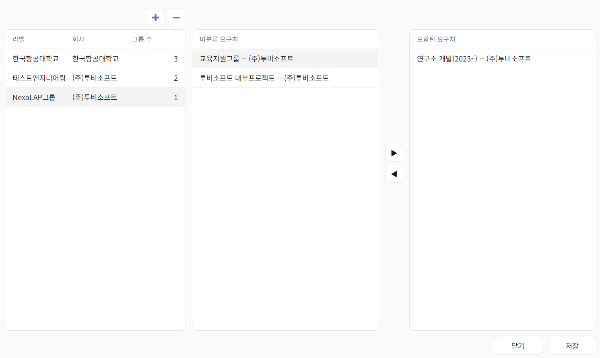

  <a href="../index.md" style="text-decoration:none; font-weight:bold; text-decoration:underline;">Home</a>
  ›
  <strong>ViewSets</strong>
  ›
  MasterShuttle_H

## 📦 Tops_Board_Asset Manual

### 🔺MasterShuttle_H
 > Master 목록과 두 목록 사이 이동 버튼으로 구성된 배정 ViewSet

 

#### 1. 기능 정의
왼쪽 Master 목록, 가운데 미배정 목록(Source), 오른쪽 선택한 Master에 배정된 목록(Target)을 나란히 두고, 두 목록 사이에 이동 버튼과 하단에 저장·닫기 버튼을 배치한 화면 구성입니다.

 

#### 2. 구성
<table>
  <thead>
    <tr>
      <th style="text-align:center; min-width:100px;">ID</th>
      <th style="text-align:center; min-width:80px;">종류</th>
      <th style="text-align:center; min-width:120px;">ViewTemplate</th>
      <th style="text-align:center; min-width:200px;">설명</th>
    </tr>
  </thead>
  <tbody>
    <tr>
      <td>Master</td>
      <td><code>View</code></td>
      <td>(Grid)</td>
      <td>왼쪽 Master 목록 (너비 30%)</td>
    </tr>
    <tr>
      <td>Source</td>
      <td><code>View</code></td>
      <td>(Grid)</td>
      <td>가운데 미배정 목록</td>
    </tr>
    <tr>
      <td>Target</td>
      <td><code>View</code></td>
      <td>(Grid)</td>
      <td>오른쪽 배정 목록</td>
    </tr>
    <tr>
      <td>btnToTarget</td>
      <td><code>Button</code></td>
      <td>-</td>
      <td>▶ 배정 버튼</td>
    </tr>
    <tr>
      <td>btnToSource</td>
      <td><code>Button</code></td>
      <td>-</td>
      <td>◀ 배정 해제 버튼</td>
    </tr>
    <tr>
      <td>btnSave</td>
      <td><code>Button</code></td>
      <td>-</td>
      <td>저장 버튼</td>
    </tr>
    <tr>
      <td>btnClose</td>
      <td><code>Button</code></td>
      <td>-</td>
      <td>닫기 버튼</td>
    </tr>
  </tbody>
</table>

 

#### 3. 참고
- Master 행 선택 시 MasterRowFilter, ▶ ◀ 버튼에 ShuttleMove, 목록 이동 후 선택 위치 조정에 SetRowPosition을 함께 사용한다.
