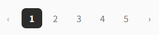

++**[Home](../index.md)**++›**Viewtemplates**›PaginationView

---

## 📦 Tops_Board_Asset Manual

### 🔸PaginationView

> 목록 하단에 건수 정보와 페이지 이동 버튼을 표시하는 ViewTemplate



  


#### 1. 기능 정의

서버 페이징 조회를 위한 페이지 이동 영역(건수 문구, 이전·번호·다음 버튼)을 구성하는 ViewTemplate입니다.

`Page role`로 현재 페이지·페이지 크기·전체 건수 필드를 지정하면, 버튼을 누를 때 현재 페이지 값을 바꾸고 숨김 버튼(`btn_pagechange`)을 클릭합니다. 이 버튼의 Click 이벤트에 조회 Transaction을 연결해 사용합니다.

  


#### 2. View Property


| 그룹           | Property명   | 유형       | 값                               | 설명                                                                                                                                      |
| ------------ | ----------- | -------- | ------------------------------- | --------------------------------------------------------------------------------------------------------------------------------------- |
| Paging       | Page size   | `Number` |                                 | 한 페이지에 보여줄 건수 (기본값: 50)                                                                                                                 |
| Button count | `Number`    |          | 한 번에 보여줄 번호 버튼 수, 1~10 (기본값: 5) |                                                                                                                                         |
| Info         | Info format | `String` |                                 | 건수 문구 형식. `{total}` 전체 건수, `{page}` 현재 페이지, `{pages}` 전체 페이지, `{from}`~`{to}` 현재 범위. 비우면 문구 숨김 (기본값: 총 {total}건 · {page} / {pages} 페이지) |
| Layout       | Align       | `Enum`   | left | center | right           | 버튼 묶음 위치 (기본값: right)                                                                                                                   |


  


#### 3. Field Property


| Property명 | 유형     | 값                                   | 설명                                                                                                                           |
| --------- | ------ | ----------------------------------- | ---------------------------------------------------------------------------------------------------------------------------- |
| Page role | `Enum` | none | index | size | total | pages | 필드 역할 설정 (index: 현재 페이지, size: 페이지 크기, total: 전체 건수, pages: 전체 페이지 수, none: 사용 안 함). pages가 없으면 total ÷ size로 계산 (기본값: none) |


  


#### 4. 참고

**사용 조건**

- **페이지 데이터 오브젝트 1개를 조회 Transaction의 Input과 Output에 모두 연결해야 한다.** 버튼을 누르면 현재 페이지(index)·페이지 크기(size)를 이 데이터 오브젝트에 기록하고, Transaction이 이를 서버로 보낸 뒤 결과(total)를 같은 데이터 오브젝트로 받는다. Output만 연결하면 서버가 조회할 페이지를 알 수 없다.
- 데이터 오브젝트에는 최소 index, size, total 역할의 컬럼이 있어야 한다 (pages는 선택). 컬럼 이름은 자유이며 Field Property `Page role`로 역할을 지정한다.
- 조회 서비스는 받은 index·size로 해당 페이지 목록을 조회하고, **Output에 index·size를 그대로 다시 돌려줘야 한다.** Output이 데이터 오브젝트를 덮어쓰므로 빠지면 항상 1페이지로 표시된다.
  ```sql
  SELECT #{ds_page.page_index}                 AS page_index,
         #{ds_page.page_size}                  AS page_size,
         COUNT(*)                              AS total_cnt,
         CEIL(COUNT(*) / #{ds_page.page_size}) AS page_cnt
  FROM ...
  ```

**연결**

- 숨김 버튼 `btn_pagechange`의 Click 이벤트에 조회 Transaction을 연결한다. 페이지 버튼을 누르면 이 버튼이 클릭된다.
- 검색 조건을 바꿔 1페이지부터 다시 조회할 때는 RunScript Action에서 View의 `fn_paging_reset()`을 호출한다.   
(예: `this.Page.form.fn_paging_reset();`)

**환경**

- 실행 중에는 런타임 라이브러리 `ViewTemplateLib/PaginationView.js`를 사용한다. 
- 페이지 버튼은 cssclass `btn_WF_Page`, 현재 페이지는 `btn_WF_PageOn`을 사용한다. 테마에 해당 클래스가 없으면 템플릿 변수 `BUTTON_CSSCLASS`를 변경한다.

