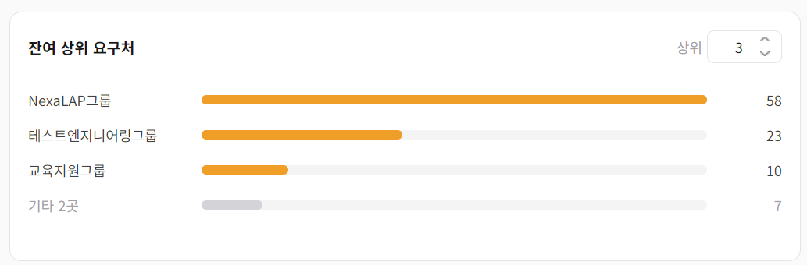

  <a href="../index.md" style="text-decoration:none; font-weight:bold; text-decoration:underline;">Home</a>
  ›
  <strong>Viewtemplates</strong>
  ›
  RankBarChart

## 📦 Tops_Board_Asset Manual

### 🔸RankBarChart
 > 데이터 행마다 가로 막대를 그리는 순위 차트 ViewTemplate

 

#### 1. 기능 정의
View 데이터의 행마다 이름과 가로 막대, 값을 한 줄씩 그리는 순위 차트 ViewTemplate입니다.

`Bar role`로 막대 이름·값·기타 구분 필드를 지정하며, 기타 구분 값이 `Etc value`인 행은 회색의 "기타" 막대로 표시합니다. 제목 줄 오른쪽에 상위 N Spin(`spnTopN`)을 표시할 수 있으며, Spin 값으로 다시 조회하는 동작은 Interaction으로 연결합니다.

 

#### 2. View Property
<table>
  <thead>
    <tr>
      <th style="text-align:center; min-width:100px;">그룹</th>
      <th style="text-align:center; min-width:100px;">Property명</th>
      <th style="text-align:center; min-width:80px;">유형</th>
      <th style="text-align:center; min-width:80px;">값</th>
      <th style="text-align:center; min-width:200px;">설명</th>
    </tr>
  </thead>
  <tbody>
    <tr>
      <td rowspan="2" style="align:center;">Header</td>
      <td>Title text</td>
      <td><code>String</code></td>
      <td></td>
      <td>제목 줄 문구. 비우면 제목 없이 Spin만 표시</td>
    </tr>
    <tr>
      <td>Empty text</td>
      <td><code>String</code></td>
      <td></td>
      <td>데이터가 없을 때 막대 영역에 표시할 문구 (기본값: 데이터가 없습니다)</td>
    </tr>
    <tr>
      <td rowspan="5" style="align:center;">Top N</td>
      <td>Use top N</td>
      <td><code>Boolean</code></td>
      <td>true | false</td>
      <td>제목 줄 오른쪽 상위 N Spin 표시 여부 (기본값: true)</td>
    </tr>
    <tr>
      <td>Top N label</td>
      <td><code>String</code></td>
      <td></td>
      <td>Spin 왼쪽 라벨 (기본값: 상위)</td>
    </tr>
    <tr>
      <td>Top N min</td>
      <td><code>Number</code></td>
      <td></td>
      <td>Spin 최솟값 (기본값: 1)</td>
    </tr>
    <tr>
      <td>Top N max</td>
      <td><code>Number</code></td>
      <td></td>
      <td>Spin 최댓값 (기본값: 15)</td>
    </tr>
    <tr>
      <td>Top N default</td>
      <td><code>Number</code></td>
      <td></td>
      <td>Spin 초기값. 조회 서비스의 기본값과 맞춰서 설정 (기본값: 5)</td>
    </tr>
    <tr>
      <td rowspan="6" style="align:center;">Bar</td>
      <td>Etc value</td>
      <td><code>String</code></td>
      <td></td>
      <td>etc 필드가 이 값이면 기타 막대로 표시 (기본값: Y)</td>
    </tr>
    <tr>
      <td>Bar color</td>
      <td><code>String</code></td>
      <td></td>
      <td>막대 색 (기본값: #EF9F27)</td>
    </tr>
    <tr>
      <td>Etc color</td>
      <td><code>String</code></td>
      <td></td>
      <td>기타 막대 색 (기본값: #D4D4D8)</td>
    </tr>
    <tr>
      <td>Track color</td>
      <td><code>String</code></td>
      <td></td>
      <td>막대 바탕(빈 부분) 색 (기본값: #F4F4F5)</td>
    </tr>
    <tr>
      <td>Label width</td>
      <td><code>Number</code></td>
      <td></td>
      <td>막대 이름 칸 너비(px) (기본값: 140)</td>
    </tr>
    <tr>
      <td>Row height</td>
      <td><code>Number</code></td>
      <td></td>
      <td>막대 한 줄 높이(px) (기본값: 30)</td>
    </tr>
  </tbody>
</table>

 

#### 3. Field Property
<table>
  <thead>
    <tr>
      <th style="text-align:center; min-width:100px;">Property명</th>
      <th style="text-align:center; min-width:80px;">유형</th>
      <th style="text-align:center; min-width:80px;">값</th>
      <th style="text-align:center; min-width:200px;">설명</th>
    </tr>
  </thead>
  <tbody>
    <tr>
      <td>Bar role</td>
      <td><code>Enum</code></td>
      <td>none | label | value | etc</td>
      <td>필드 역할 설정 (label: 막대 이름, value: 막대 값, etc: 기타 구분, none: 사용 안 함)</td>
    </tr>
  </tbody>
</table>
