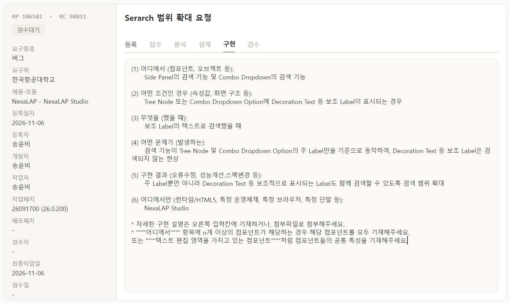

  <a href="../index.md" style="text-decoration:none; font-weight:bold; text-decoration:underline;">Home</a>
  ›
  <strong>Viewtemplates</strong>
  ›
  RecordDetailView

## 📦 Tops_Board_Asset Manual

### 🔸RecordDetailView
 > 레코드 1건의 상세 내용을 보여주는 ViewTemplate

 

#### 1. 기능 정의
View 데이터의 현재 행 1건을 왼쪽 정보 영역(번호, 상태 배지, 정보 목록)과 오른쪽 본문 영역(제목, 탭별 긴 텍스트)으로 나누어 보여주는 ViewTemplate입니다.

`Field role`로 각 필드가 표시될 위치를 정하고, 본문(body) 필드는 `Tab group`으로 탭을 묶을 수 있습니다. 내용이 비어 있는 본문에는 `Empty text`를 표시합니다.

 

#### 2. View Property
<table>
  <thead>
    <tr>
      <th style="text-align:center; min-width:100px;">그룹</th>
      <th style="text-align:center; min-width:100px;">Property명</th>
      <th style="text-align:center; min-width:80px;">유형</th>
      <th style="text-align:center; min-width:80px;">값</th>
      <th style="text-align:center; min-width:200px;">설명</th>
    </tr>
  </thead>
  <tbody>
    <tr>
      <td rowspan="1" style="align:center;">Layout</td>
      <td>Side width</td>
      <td><code>Number</code></td>
      <td></td>
      <td>왼쪽 정보 영역 너비(px) (기본값: 220)</td>
    </tr>
    <tr>
      <td rowspan="2" style="align:center;">Body</td>
      <td>Empty text</td>
      <td><code>String</code></td>
      <td></td>
      <td>본문 내용이 비었을 때 표시 문구 (기본값: 내용이 없어요)</td>
    </tr>
    <tr>
      <td>Default tab</td>
      <td><code>Enum</code></td>
      <td>last | first</td>
      <td>처음 열 탭 설정 (last: 내용 있는 마지막 탭, first: 내용 있는 첫 탭, 기본값: last)</td>
    </tr>
    <tr>
      <td rowspan="1" style="align:center;">Badge</td>
      <td>Badge tone map</td>
      <td><code>String</code></td>
      <td></td>
      <td>badgetone 값 → 배지 색(:배지 뒤 문구) 설정. 예) <code>A:warning:잔여,B:success:완료</code> (색: neutral / info / success / warning / danger)</td>
    </tr>
  </tbody>
</table>

 

#### 3. Field Property
<table>
  <thead>
    <tr>
      <th style="text-align:center; min-width:100px;">Property명</th>
      <th style="text-align:center; min-width:80px;">유형</th>
      <th style="text-align:center; min-width:80px;">값</th>
      <th style="text-align:center; min-width:200px;">설명</th>
    </tr>
  </thead>
  <tbody>
    <tr>
      <td>Field role</td>
      <td><code>Enum</code></td>
      <td>info | key | badge | badgetone | title | body | none</td>
      <td>필드 표시 위치 설정 (key: 번호, 여러 개 가능 / badge: 상태 배지 / badgetone: 배지 색 기준, 표시 안 함 / title: 제목 / info: 왼쪽 정보 / body: 오른쪽 탭 / none: 표시 안 함, 기본값: info)</td>
    </tr>
    <tr>
      <td>Tab group</td>
      <td><code>String</code></td>
      <td></td>
      <td>body 필드 전용. 같은 이름끼리 한 탭에 위아래로 표시 (탭 이름 = 그룹 이름). 비우면 필드마다 탭 1개</td>
    </tr>
  </tbody>
</table>
