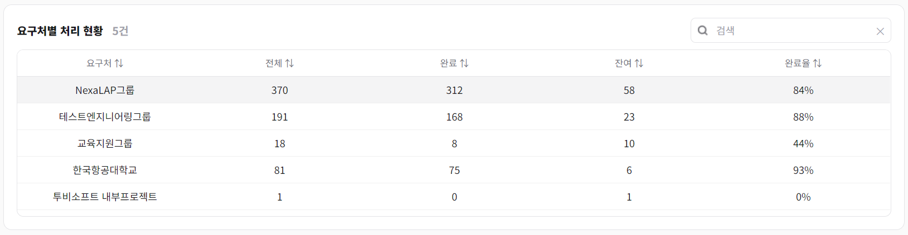

  <a href="../index.md" style="text-decoration:none; font-weight:bold; text-decoration:underline;">Home</a>
  ›
  <strong>Viewtemplates</strong>
  ›
  SearchGridView

## 📦 Tops_Board_Asset Manual

### 🔸SearchGridView
 > 제목·건수·검색칸·헤더 정렬을 갖춘 Grid ViewTemplate

 

#### 1. 기능 정의
카드 형태의 프레임 안에 제목과 건수, 키워드 검색칸, 지우기 버튼, Grid를 배치하는 ViewTemplate입니다.

헤더를 클릭하면 해당 컬럼으로 정렬되고 다시 누르면 오름차순·내림차순이 바뀝니다. 검색칸(`edt_filterSearch`)과 지우기 버튼(`btn_searchClear`)의 필터 동작은 InputFilter Action을 연결해 구성합니다.

 

#### 2. View Property
<table>
  <thead>
    <tr>
      <th style="text-align:center; min-width:100px;">그룹</th>
      <th style="text-align:center; min-width:100px;">Property명</th>
      <th style="text-align:center; min-width:80px;">유형</th>
      <th style="text-align:center; min-width:80px;">값</th>
      <th style="text-align:center; min-width:200px;">설명</th>
    </tr>
  </thead>
  <tbody>
    <tr>
      <td rowspan="2" style="align:center;">Title</td>
      <td>Title text</td>
      <td><code>String</code></td>
      <td></td>
      <td>제목 설정. 비우면 제목 없이 검색칸만 표시</td>
    </tr>
    <tr>
      <td>Show count</td>
      <td><code>Boolean</code></td>
      <td>true | false</td>
      <td>제목 옆 건수 표시 여부 (필터 중이면 '보이는 건수 / 전체 건수', 기본값: true)</td>
    </tr>
    <tr>
      <td rowspan="3" style="align:center;">Search</td>
      <td>Use search</td>
      <td><code>Boolean</code></td>
      <td>true | false</td>
      <td>검색칸과 지우기 버튼 표시 여부 (기본값: true)</td>
    </tr>
    <tr>
      <td>Search placeholder</td>
      <td><code>String</code></td>
      <td></td>
      <td>검색칸 안내 문구 (기본값: 검색)</td>
    </tr>
    <tr>
      <td>Search Width</td>
      <td><code>Number</code></td>
      <td></td>
      <td>검색칸 너비(px) (기본값: 240)</td>
    </tr>
    <tr>
      <td rowspan="3" style="align:center;">Sort</td>
      <td>Use head sort</td>
      <td><code>Boolean</code></td>
      <td>true | false</td>
      <td>헤더 클릭 정렬 사용 여부 (기본값: true)</td>
    </tr>
    <tr>
      <td>Select first after sort</td>
      <td><code>Boolean</code></td>
      <td>true | false</td>
      <td>정렬 후 첫 행 선택 여부. 행 변경 이벤트에 연결된 Interaction이 이어서 실행됨 (기본값: true)</td>
    </tr>
    <tr>
      <td>Default sort</td>
      <td><code>String</code></td>
      <td></td>
      <td>처음 정렬 컬럼 설정 (<code>-컬럼</code>: 내림차순, <code>+컬럼</code>: 오름차순)</td>
    </tr>
    <tr>
      <td rowspan="3" style="align:center;">Grid</td>
      <td>Layout</td>
      <td><code>GridLayout</code></td>
      <td></td>
      <td>Grid Layout 설정</td>
    </tr>
    <tr>
      <td>Autofit</td>
      <td><code>Enum</code></td>
      <td>none | col</td>
      <td>Column 너비 자동 설정 여부 (기본값: col)</td>
    </tr>
    <tr>
      <td>No data text</td>
      <td><code>String</code></td>
      <td></td>
      <td>행이 없을 때(검색 결과 0건 포함) 표시할 문구 (기본값: 데이터가 없습니다)</td>
    </tr>
  </tbody>
</table>

 

#### 3. Field Property
<table>
  <thead>
    <tr>
      <th style="text-align:center; min-width:100px;">Property명</th>
      <th style="text-align:center; min-width:80px;">유형</th>
      <th style="text-align:center; min-width:80px;">값</th>
      <th style="text-align:center; min-width:200px;">설명</th>
    </tr>
  </thead>
  <tbody>
    <tr>
      <td>Display type</td>
      <td><code>Enum</code></td>
      <td>auto | normal | none | buttoncontrol | calendarcontrol | date | checkboxcontrol | combocontrol | combotext | currency | decoratetext | editcontrol | imagecontrol | mask | maskeditcontrol | multicombocontrol | number | progressbarcontrol | text | textareacontrol | treeitemcontrol</td>
      <td>Cell에 표시될 Component 설정 (기본값: auto)</td>
    </tr>
    <tr>
      <td>Edit type</td>
      <td><code>Enum</code></td>
      <td>auto | normal | none | button | checkbox | combo | date | mask | multicombo | readonly | text | textarea | tree</td>
      <td>Cell이 Edit 모드일 때 표시될 Component 설정 (기본값: none)</td>
    </tr>
  </tbody>
</table>
