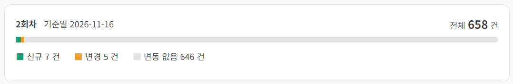

  <a href="../index.md" style="text-decoration:none; font-weight:bold; text-decoration:underline;">Home</a>
  ›
  <strong>Viewtemplates</strong>
  ›
  SummaryBarView

## 📦 Tops_Board_Asset Manual

### 🔸SummaryBarView
 > 현재 행의 합계와 구간별 비율을 한 줄 막대로 보여주는 ViewTemplate

 

#### 1. 기능 정의
View 데이터의 현재 행에서 선택한 필드들을 구간으로, `Total field`를 전체 길이로 삼아 비율 막대 하나와 범례를 그리는 ViewTemplate입니다.

합계에서 구간 값들을 뺀 나머지는 `Rest label`, `Rest color`로 표시합니다.

 

#### 2. View Property
<table>
  <thead>
    <tr>
      <th style="text-align:center; min-width:100px;">그룹</th>
      <th style="text-align:center; min-width:100px;">Property명</th>
      <th style="text-align:center; min-width:80px;">유형</th>
      <th style="text-align:center; min-width:80px;">값</th>
      <th style="text-align:center; min-width:200px;">설명</th>
    </tr>
  </thead>
  <tbody>
    <tr>
      <td rowspan="2" style="align:center;">Header</td>
      <td>Header format</td>
      <td><code>String</code></td>
      <td></td>
      <td>제목 형식. <code>{필드ID}</code>를 현재 행 값으로 치환, <code>&lt;b v='true'&gt;굵게&lt;/b&gt;</code> 사용 가능</td>
    </tr>
    <tr>
      <td>Empty text</td>
      <td><code>String</code></td>
      <td></td>
      <td>데이터가 없을 때 제목 문구 (기본값: 데이터가 없습니다)</td>
    </tr>
    <tr>
      <td rowspan="4" style="align:center;">Total</td>
      <td>Total field</td>
      <td><code>String</code></td>
      <td></td>
      <td>합계로 쓸 필드 ID (막대 전체 길이 기준)</td>
    </tr>
    <tr>
      <td>Total label</td>
      <td><code>String</code></td>
      <td></td>
      <td>합계 앞에 붙일 문구 (기본값: 전체)</td>
    </tr>
    <tr>
      <td>Rest label</td>
      <td><code>String</code></td>
      <td></td>
      <td>나머지의 범례 문구 (기본값: 나머지)</td>
    </tr>
    <tr>
      <td>Value suffix</td>
      <td><code>String</code></td>
      <td></td>
      <td>건수 뒤에 붙일 단위 (예: 건)</td>
    </tr>
    <tr>
      <td rowspan="2" style="align:center;">Bar</td>
      <td>Segment colors</td>
      <td><code>String</code></td>
      <td></td>
      <td>구간 색, 선택한 필드 순서대로 쉼표 구분 (기본값: #1D9E75,#EF9F27,#378ADD,#D4537E)</td>
    </tr>
    <tr>
      <td>Rest color</td>
      <td><code>String</code></td>
      <td></td>
      <td>나머지(막대 바탕) 색 (기본값: #E4E4E7)</td>
    </tr>
  </tbody>
</table>
