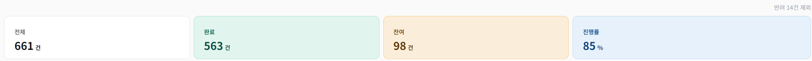

  <a href="../index.md" style="text-decoration:none; font-weight:bold; text-decoration:underline;">Home</a>
  ›
  <strong>Viewtemplates</strong>
  ›
  SummaryCardView

## 📦 Tops_Board_Asset Manual

### 🔸SummaryCardView
 > 현재 행의 값을 여러 개의 카드로 보여주는 요약 ViewTemplate

 

#### 1. 기능 정의
View 데이터의 현재 행에서 선택한 필드마다 카드 하나(라벨 + 값)를 가로로 배치하는 ViewTemplate입니다.

카드의 배경·테두리·글자 색은 카드 순서대로 지정하며, `Header format`으로 카드 위에 현재 행 값을 넣은 제목 줄을 표시할 수 있습니다.

 

#### 2. View Property
<table>
  <thead>
    <tr>
      <th style="text-align:center; min-width:100px;">그룹</th>
      <th style="text-align:center; min-width:100px;">Property명</th>
      <th style="text-align:center; min-width:80px;">유형</th>
      <th style="text-align:center; min-width:80px;">값</th>
      <th style="text-align:center; min-width:200px;">설명</th>
    </tr>
  </thead>
  <tbody>
    <tr>
      <td rowspan="3" style="align:center;">Header</td>
      <td>Header fields</td>
      <td><code>String</code></td>
      <td></td>
      <td>선택한 필드 중 카드로 만들지 않을 필드 ID (쉼표 구분). 제목 줄에만 쓸 필드 지정용</td>
    </tr>
    <tr>
      <td>Header format</td>
      <td><code>String</code></td>
      <td></td>
      <td>제목 줄 형식. <code>{필드ID}</code>를 현재 행 값으로 치환, <code>&lt;b v='true'&gt;굵게&lt;/b&gt;</code> 사용 가능. 비우면 제목 줄 없음</td>
    </tr>
    <tr>
      <td>Empty text</td>
      <td><code>String</code></td>
      <td></td>
      <td>데이터가 없을 때 제목 줄 문구 (기본값: 데이터가 없습니다)</td>
    </tr>
    <tr>
      <td rowspan="6" style="align:center;">Card</td>
      <td>Card colors</td>
      <td><code>String</code></td>
      <td></td>
      <td>카드 배경색, 카드 순서대로 쉼표 구분 (기본값: #F4F4F5,#E1F5EE,#FAEEDA,#E6F1FB)</td>
    </tr>
    <tr>
      <td>Border colors</td>
      <td><code>String</code></td>
      <td></td>
      <td>카드 테두리색, 카드 순서대로 쉼표 구분 (기본값: #E4E4E7,#9FE1CB,#FAC775,#B5D4F4)</td>
    </tr>
    <tr>
      <td>Label colors</td>
      <td><code>String</code></td>
      <td></td>
      <td>카드 라벨 글자색, 카드 순서대로 쉼표 구분 (기본값: #71717A,#0F6E56,#854F0B,#185FA5)</td>
    </tr>
    <tr>
      <td>Value colors</td>
      <td><code>String</code></td>
      <td></td>
      <td>카드 값 글자색, 카드 순서대로 쉼표 구분 (기본값: #18181B,#085041,#633806,#0C447C)</td>
    </tr>
    <tr>
      <td>Value font size</td>
      <td><code>Number</code></td>
      <td></td>
      <td>카드 값 글자 크기(px) (기본값: 22)</td>
    </tr>
    <tr>
      <td>Card gap</td>
      <td><code>Number</code></td>
      <td></td>
      <td>카드 사이 간격(px) (기본값: 8)</td>
    </tr>
  </tbody>
</table>

 

#### 3. Field Property
<table>
  <thead>
    <tr>
      <th style="text-align:center; min-width:100px;">Property명</th>
      <th style="text-align:center; min-width:80px;">유형</th>
      <th style="text-align:center; min-width:80px;">값</th>
      <th style="text-align:center; min-width:200px;">설명</th>
    </tr>
  </thead>
  <tbody>
    <tr>
      <td>Value suffix</td>
      <td><code>String</code></td>
      <td></td>
      <td>값 뒤에 작게 붙일 단위 (예: 건, %)</td>
    </tr>
  </tbody>
</table>
